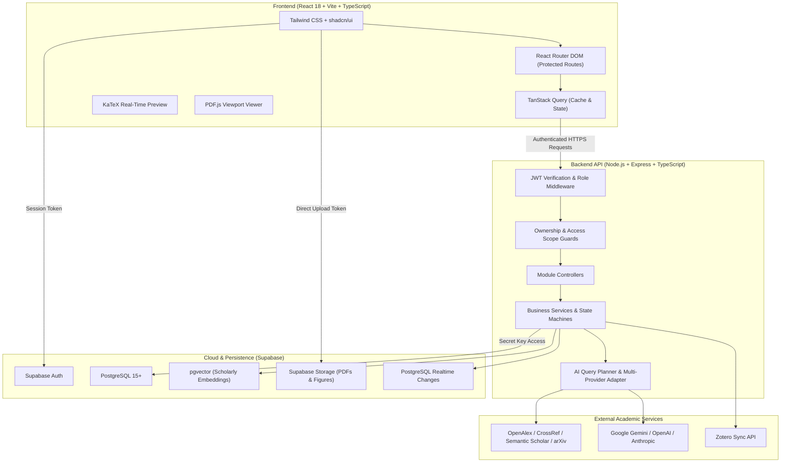

<div align="center">

# 🔬 ResearchOS

**An End-to-End Operating System for Academic Research, Collaborative Discovery & Scholarly Governance**

[](https://react.dev/)
[](https://www.typescriptlang.org/)
[](https://vitejs.dev/)
[](https://nodejs.org/)
[](https://expressjs.com/)
[](https://supabase.com/)
[](https://tailwindcss.com/)
[](https://vitest.dev/)
[](LICENSE)

<br />

[Features](#-core-modules--features) • [System Architecture](#-system-architecture) • [Getting Started](#-getting-started) • [Testing](#-running-tests) • [Documentation](#-documentation)

---

</div>

## 📖 Overview

**ResearchOS** is a comprehensive, production-grade web application built to streamline and unify the entire lifecycle of scientific research. It bridges the gap between raw experimental workflows, collaborative literature exploration, peer review, manuscript authoring, and institutional governance.

By replacing disconnected tools (spreadsheets, reference managers, scattered scripts, and email threads), ResearchOS offers a centralized platform where **Researchers**, **Supervisors**, and **Administrators** collaborate securely in real-time.

---

## ⚡ Core Modules & Features

```
ResearchOS Modular Ecosystem
├── 🛡️ Module 01: Auth & Role-Based Access Control (Admin | Supervisor | Researcher)
├── 🗺️ Module 02: Research Workspace & Interactive Milestone Roadmap
├── 📚 Module 03: Literature Manager, Zotero Sync & PDF Annotation Viewer
├── 🧪 Module 04: Experiment Tracker, Benchmark Matrix & Code Playground
├── ✍️ Module 05: Side-by-Side Manuscript Editor, Real-time LaTeX Preview & Peer Review
├── 💬 Module 06: Peer Community Forum, Reactions & Reputation Badges
├── 🔬 Module 07: Academic Equipment Marketplace & Service Booking
├── 🤖 Module 08: Perplexity-Style AI Query Planner & Multi-Source Scholarly Retrieval
└── 🏛️ Module 09: System Admin Command Center, Telemetry & Compliance Governance
```

<details open>
<summary><b>🔍 Detailed Breakdown of Capabilities</b></summary>

### 1. 🛡️ Identity & Role-Based Access Control (RBAC)
* Seamless Supabase Authentication (Email/Password, OAuth).
* Strict three-tier institutional RBAC: **Admin**, **Supervisor**, and **Researcher**.
* Server-side JWT verification with cached JWKS public keys and live database profile status checks (`Active`, `PendingVerification`, `Suspended`).

### 2. 🗺️ Research Workspace & Visual Milestone Roadmap
* Project lifecycles with granular member permissions (`Owner`, `Collaborator`, `Viewer`).
* Interactive sequential **Research Journey Roadmap** visualizing milestone progress, target dates, and task completion.
* Dynamic activity stream tracking team events, task allocations, and milestone completions.

### 3. 📚 Scholarly Literature Manager & Interactive PDF Viewer
* Direct integration with OpenAlex, Semantic Scholar, CrossRef, and arXiv.
* Zotero bibliographic library synchronization and BibTeX import/export.
* Custom progressive PDF viewer with viewport rendering, in-document highlight popovers, and margin annotation notes.

### 4. 🧪 Experiment Tracker & Code Playground
* Systematic logging of experimental trials, hyperparameters, metrics, and dataset versions.
* Interactive visual comparison matrix for model benchmarks.
* Supervisor verification workflow with quality badge endorsements and revision flags.
* Sandboxed interactive code execution playground for quick exploratory scripts.

### 5. ✍️ Manuscript Authoring & Blind Peer Review Hub
* Split-pane manuscript editor with live KaTeX LaTeX mathematical rendering.
* Context-aware inline citations with contextual *"Why did I cite this?"* explanation modals.
* Section management (Abstract, Methodology, Results, Discussion, References) with word count analysis.
* Version history snapshots with instant diffs.
* Multi-stage peer review workflow (Internal Draft &rarr; Under Internal Review &rarr; Revision Requested &rarr; Approved for Submission) with threaded reviewer comments.

### 6. 💬 Academic Forum & Scholarly Community
* Institutional knowledge exchange with rich text questions, categorized topics, and code formatting.
* Emoji reaction system, upvoting, and reputation scoring based on community engagement.
* Direct messaging and project collaboration requests.

### 7. 🔬 Equipment Marketplace & Facility Booking
* Centralized catalog of institutional laboratory equipment, sensors, and computing clusters.
* Real-time availability calendars with slot reservation and supervisor sign-off workflows.

### 8. 🤖 AI Scholarly Assistant & Query Planner
* Provider-agnostic AI adapter supporting Google Gemini, OpenAI, Anthropic, and local LLMs.
* Perplexity-style scholarly query decomposition: searches across academic databases, synthesizes literature, extracts methodology insights, and auto-generates citations.

### 9. 🏛️ Admin Command Center & Governance
* Comprehensive platform overview: active researchers, compute usage, pending verifications, and system health metrics.
* Audit trail logging all administrative and security actions.
* User directory management, account status controls, and GDPR-compliant automated deletion request handlers.

</details>

---

## 🏗️ System Architecture



---

## 🛠️ Technology Stack

| Layer | Technologies |
| :--- | :--- |
| **Frontend** | React 18, Vite, TypeScript, Tailwind CSS, Lucide Icons, Radix UI, TanStack Query, React Router DOM, KaTeX, PDF.js |
| **Backend** | Node.js, Express, TypeScript, Zod, `@supabase/supabase-js`, CORS, Helmet, Rate Limiter |
| **Database** | PostgreSQL 15+, `pgvector` extension, Supabase Auth, Row-Level Security (RLS) |
| **AI Integration** | Provider-agnostic adapter (Google Gemini API, OpenAI, Anthropic Claude), Semantic Embeddings |
| **Monorepo Tooling** | `pnpm` workspaces, TypeScript project references |
| **Testing** | Vitest, React Testing Library, Supertest, JSDOM |

---

## 🚀 Getting Started

### Prerequisites

Ensure you have the following installed on your machine:
* [Node.js](https://nodejs.org/) (v20.x or higher recommended)
* [pnpm](https://pnpm.io/) (`npm install -g pnpm`)
* A [Supabase](https://supabase.com/) project (Cloud or local Supabase CLI)

### Installation

1. **Clone the repository:**
   ```bash
   git clone https://github.com/GofranEmonKhan/ResearchOS_262.git
   cd ResearchOS_262
   ```

2. **Install all workspace dependencies:**
   ```bash
   pnpm install
   ```

3. **Configure Environment Variables:**

   Create `.env` in `apps/api/`:
   ```env
   PORT=5000
   NODE_ENV=development
   SUPABASE_URL=https://your-project.supabase.co
   SUPABASE_SERVICE_ROLE_KEY=your_supabase_secret_service_role_key
   SUPABASE_JWT_SECRET=your_supabase_jwt_secret
   GEMINI_API_KEY=your_gemini_api_key_optional
   ```

   Create `.env` in `apps/web/`:
   ```env
   VITE_API_URL=http://localhost:5000/api
   VITE_SUPABASE_URL=https://your-project.supabase.co
   VITE_SUPABASE_ANON_KEY=your_supabase_publishable_anon_key
   ```

4. **Initialize Database Schema:**
   Apply database migrations located in `supabase/migrations/` using the Supabase CLI or Dashboard SQL editor:
   ```bash
   pnpm supabase db push
   # or apply files in supabase/migrations/ sequentially
   ```

5. **Start the Development Servers:**
   ```bash
   # Run both frontend and backend concurrently
   pnpm dev
   ```
   * Frontend: `http://localhost:5173`
   * Backend API: `http://localhost:5000`

---

## 🧪 Running Tests

ResearchOS features a comprehensive unit, integration, and UI component test suite powered by **Vitest**:

```bash
# Run all workspace test suites
pnpm test

# Run backend API test suite specifically
pnpm --filter @researchos/api test

# Run frontend UI component tests
pnpm --filter @researchos/web test
```

> 💡 *For an extensive, beginner-friendly walkthrough on test execution, mock environments, and troubleshooting, refer to [HOW_TO_RUN_TESTS.md](HOW_TO_RUN_TESTS.md).*

---

## 📂 Project Structure

```text
ResearchOS/
├── apps/
│   ├── api/                    # Node.js + Express backend application
│   │   ├── src/
│   │   │   ├── config/         # Environment & database clients
│   │   │   ├── middleware/     # Auth, RBAC & error handlers
│   │   │   ├── routes/         # REST API route endpoints
│   │   │   ├── services/       # Domain business logic & state transitions
│   │   │   └── tests/          # API integration and security tests
│   │   └── package.json
│   └── web/                    # React 18 + Vite frontend application
│       ├── src/
│       │   ├── components/     # UI components (Admin, AI, Literature, Manuscripts)
│       │   ├── context/        # Auth & application state providers
│       │   ├── lib/            # API client and utility helpers
│       │   ├── pages/          # Application views & role-based dashboards
│       │   └── tests/          # Frontend component and view tests
│       └── package.json
├── packages/
│   ├── config/                 # Shared TypeScript configurations
│   └── shared-types/           # Shared TypeScript interfaces, DTOs & enums
├── supabase/
│   ├── migrations/             # Single source of truth SQL migrations
│   └── seed.sql                # Demonstration seed datasets
├── docs/
│   └── guides/                 # User guides and feature walkthroughs
├── HOW_TO_RUN_TESTS.md         # Comprehensive test execution guide
├── TESTING_GUIDE.md            # Testing patterns and architecture guide
└── README.md                   # Project documentation
```

---

## 📚 Documentation

* 🧪 **[Testing Execution Guide](HOW_TO_RUN_TESTS.md)** — Step-by-step instructions for running tests across services.
* 📋 **[Test Architecture Guide](TESTING_GUIDE.md)** — Technical details on mock strategies, fixtures, and assertions.
* 🤖 **[AI Research Assistant Guide](docs/guides/ai-research-assistant-user-guide.md)** — Deep dive into scholarly retrieval and query planning.

---

## 📄 License

This project is licensed under the [MIT License](LICENSE).
